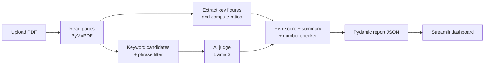

# FinLens: Financial Document Intelligence & Risk Screener

[](https://minor-project-2026-cwh7njkikl8oxhg2qqvnj7.streamlit.app/)

**Live demo:**[ https://minor-project-2026.streamlit.app](https://minor-project-2026-cwh7njkikl8oxhg2qqvnj7.streamlit.app/)

FinLens reads a long annual report (PDF) and gives you the key financial figures, risk warnings with page numbers, a 0–100 risk score and a plain-English summary, so a human reviewer knows where to look first.

> Minor project 2026 · B.Tech AI & ML · Dr. APJ Abdul Kalam Government Institute of Technology, Tanakpur (VMSBUTU, Dehradun)

---

## Why this project

- **Annual reports are long.** The Infosys report we tested has 380+ pages, and the risks sit deep in the notes and the auditor's report.
- **Keyword search cries wolf.** Words like "fraud" and "going concern" appear in standard legal sentences in almost every report.
- **AI alone can't be trusted with numbers.** Language models make arithmetic mistakes and can invent figures.

## Design rule

> **Code does the maths. The AI does the judgement. Every claim has a page.**

1. All figures and ratios are located and calculated in Python, never by the language model.
2. The language model only judges one sentence at a time: has something bad really happened, or is this a standard legal line?
3. Every figure and flag carries its page number, and the generated summary is checked before it is shown.

## What it does

- Reads a PDF with PyMuPDF (text, tables, image count, page numbers).
- Extracts **total income, profit, total assets and total equity** for the current and previous year, with the page of each figure. You choose **Standalone** or **Consolidated**, and only that section is read.
- Computes income growth, profit growth, profit margin and equity-to-assets in code.
- Searches for ten risk keywords, removes standard legal phrases, and asks an AI judge whether each remaining sentence describes a real problem.
- Produces a **risk score (0–100)** with a simple, explainable rule.
- Writes a short **executive summary** with a number checker: if the summary contains a number that is not in the extracted facts, it is replaced by a safe template.
- Shows everything in a **Streamlit dashboard** with metric cards, charts, a risk gauge, flagged items (sentence + page + severity) and a question box.
- Caches results by file hash and statement basis, so a repeat upload loads instantly.

## How it works



### Risk score

| Item | Rule |
|---|---|
| High-severity confirmed flag | 25 points |
| Medium-severity confirmed flag | 10 points |
| Flags counted per risk type | at most 2 |
| Maximum score | 100 |

This is a rule-of-thumb indicator, not a statistical model, and it has not yet been validated on failing companies.

### Risk keywords

`going concern` · `material weakness` · `restatement` · `qualified opinion` · `fraud` (high) · `litigation` · `impairment` · `penalty` · `default` (medium) · `cyber` (low, not scored)

## Results (Infosys Integrated Annual Report 2025–26, Standalone)

| Measure | Result |
|---|---|
| Income growth | 9.9% (matches the report's own figure) |
| Profit growth | 14.2% |
| Profit margin | 18.8% |
| Equity to assets | 63.8% |
| Keyword candidates → flags | 101 → 3 |
| AI judge on hand-checked sample | 18 / 20 correct |
| AI judge on constructed sentences | 9 / 9 correct |
| Risk score | 30 / 100 |

These numbers come from the project report's test run with the earlier local-model version of the pipeline. The judging step has been changed since (batched calls), so re-measure before quoting them as current.

## Getting started

### Prerequisites

- Python 3.10 or newer
- A [Groq API key](https://console.groq.com) for the cloud AI judge (recommended), **or** [Ollama](https://ollama.com) with the `llama3.2:3b` model for fully local use

### Install and run

```bash
git clone https://github.com/Vanshika-mohiley/minor-project-2026.git
cd minor-project-2026

python -m venv venv
source venv/bin/activate        # Windows: venv\Scripts\activate

pip install -r frontend/requirements.txt

# Cloud AI judge (recommended)
export GROQ_API_KEY="your-key-here"     # Windows PowerShell: $env:GROQ_API_KEY="your-key-here"

streamlit run frontend/app.py
```

Then upload an annual report PDF in the sidebar, choose **Standalone** or **Consolidated**, and wait for the analysis to finish.

### Fully local mode (no cloud)

If `GROQ_API_KEY` is not set, the app falls back to Ollama:

```bash
pip install ollama
ollama pull llama3.2:3b
streamlit run frontend/app.py
```

### Configuration

| Variable | Purpose | Default |
|---|---|---|
| `GROQ_API_KEY` | Enables the cloud AI judge and summary writer | not set (falls back to Ollama) |
| `LLM_MODEL` | Groq model name | `llama-3.1-8b-instant` |

Keep keys out of Git. `.env` is already in `.gitignore`.

### Deploy on Streamlit Community Cloud

1. Push the repo to GitHub.
2. On [share.streamlit.io](https://share.streamlit.io), create a new app from this repository.
3. Set the main file path to `frontend/app.py`.
4. Under **Advanced settings → Secrets**, add:
   ```toml
   GROQ_API_KEY = "your-key-here"
   ```
5. Deploy, then put the app URL at the top of this README.

### Run the tests

```bash
cd ai_ml_layer
pip install pytest
pytest
```

Some checks in `tests/run_all.py` expect a `sample_report.pdf` in `ai_ml_layer/`. PDFs are gitignored, so add your own annual report under that name to run them.

## Project structure

```
minor-project-2026/
├── ai_ml_layer/
│   ├── analysis/
│   │   ├── pdf_reader.py     # reads text, tables and image counts per page
│   │   ├── metrics.py        # finds key figures and calculates growth
│   │   ├── risk.py           # keywords, severities, standard-phrase filter
│   │   ├── judge.py          # AI judge (Groq cloud or local Ollama)
│   │   ├── pipeline.py       # confirms risks and computes the risk score
│   │   ├── summarize.py      # AI summary with number checker and fallback
│   │   ├── analyze.py        # PDF in, validated AnalysisReport out
│   │   └── schemas.py        # Pydantic models for the JSON report
│   ├── tests/                # automated tests
│   ├── sample_output.json    # example report (shown when nothing is uploaded)
│   └── requirements.txt
└── frontend/
    ├── app.py                # Streamlit dashboard
    └── requirements.txt
```

### Output format

`analyze()` returns one validated report:

```json
{
  "doc_id": "report.pdf",
  "summary": "…",
  "metrics": {
    "basis": "Standalone",
    "unit": "INR crore",
    "total_income": { "this_year": 155310.0, "last_year": 141374.0, "page": 33 },
    "income_growth_pct": 9.9,
    "profit_margin_pct": 18.8
  },
  "risk_flags": [
    { "type": "penalty", "severity": "medium", "page": 152, "evidence": "…" }
  ],
  "risk_score": 30
}
```

## Limitations

- Tested on **one report from one healthy company**. A company with real going-concern or audit problems has not been tested yet.
- The AI judge is a small model and still misreads some sentences that say something "may" happen.
- The judging step checks up to 15 unique candidate snippets per report.
- Figures are read from text and tables only. Charts, images and scanned pages are not read.
- The question box answers from the extracted report data (income, profit, equity, risks) using keyword matching. Retrieval over the whole document is not built yet.
- The unit is currently shown as INR crore, and metric labels (for example "total income") are matched by exact wording, so other report formats may need adjustments.
- The risk score ignores the money size of an item and has not been validated.

## Roadmap

- [ ] Vector database and retrieval-augmented generation (RAG) for page-cited question answering
- [ ] Test on companies with going-concern or audit warnings
- [ ] OCR and vision models for scanned pages and charts
- [ ] Materiality-weighted risk score and year-on-year comparison
- [ ] Automatic Standalone / Consolidated detection
- [ ] Support for more report formats and currencies

## Team

| Name | Role |
|---|---|
| Surbhi Arora | Team leader, frontend |
| Vanshika Mohiley | Backend |
| Divyanshi Bisht | UI / UX |
| Pranjal Sharma | LLM integration |

**Guide:** Ms. Neha Bisht, Assistant Professor, Dept. of AI & ML

## Disclaimer

FinLens is a screening aid. It points reviewers to the pages that need attention. It does not replace an auditor or analyst and does not give investment advice.
